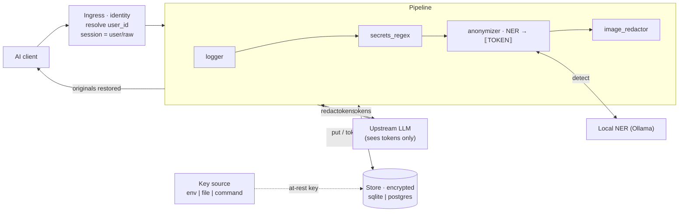

# aiproxy

Anonymizing reverse proxy for LLM APIs. Point Claude Code (or any AI tool)
at aiproxy; it scrubs people/company names and other sensitive content with
a **local** LLM before forwarding to Anthropic, then restores the originals
in the reply. Pluggable filter/processor interface. Handles text, images,
PDFs.

```
AI tool ──▶ aiproxy ──(redacted)──▶ Anthropic
   ▲            │                       │
   └─(restored)─┴───────(tokens)────────┘
```

- Reversible anonymization: originals ↔ tokens kept in a local encrypted store.
- One `Processor` interface — drop in your own filters (or reviewed [plugins](docs/WRITING_A_PROCESSOR.md)).
- Ships: `secrets_regex`, `anonymizer` (local-LLM NER), `image_redactor`, `logger`.
- `/dryrun` endpoint to preview redactions before trusting it.
- Scales to a shared org service: per-user identity + isolation, self-service
  term lists (`/terms`), SQLite **or** Postgres store, config hot-reload
  (`SIGHUP`), secrets-manager key sourcing, `/readyz`. See
  [`docs/ORG_DEPLOYMENT.md`](docs/ORG_DEPLOYMENT.md).

Full install + usage: [`docs/MANUAL.md`](docs/MANUAL.md).

## Architecture
The pipeline redacts on the way out and restores on the way in; the upstream
API only ever sees tokens. Both directions share the encrypted store and the
local NER model.



Scaled to a shared org service it runs stateless frontends behind a load
balancer over a shared Postgres store and NER service — diagrams and design in
[`docs/MANUAL.md#1b-architecture`](docs/MANUAL.md#1b-architecture) and
[`docs/ORG_DEPLOYMENT.md`](docs/ORG_DEPLOYMENT.md).

## Install

Two deployment shapes — pick the one that fits. Full detail for each is in the
manual: [single workstation](docs/MANUAL.md#2-install--single-workstation) ·
[organization](docs/MANUAL.md#2b-install--organization).

### A · Single workstation
One person, one machine; local SQLite store and local NER model.

**Requirements**

| | Minimum | Comfortable |
|---|---|---|
| OS | macOS, Linux, or Windows 10+ | same |
| Python | 3.11+ | 3.11+ |
| RAM free | 6 GB (CPU-only NER) | 8 GB+ |
| GPU | none — runs on CPU | any GPU with ≥ 4 GB VRAM (much faster NER + pre-warm) |
| Disk | ~4 GB (deps + the 3B NER model) | SSD |
| Also installed | Ollama (local LLM runtime) and the Tesseract OCR binary — the installer handles both | |

The default NER model is `qwen2.5:3b-instruct` (~2 GB). OCR runs on CPU.

**One-command install** — sets up the venv + deps, Ollama (and starts it),
Tesseract, the NER model, a store key, and `config.yaml`:
```bash
./install.sh                                           # macOS / Linux
powershell -ExecutionPolicy Bypass -File .\install.ps1 # Windows
```
Then verify and run:
```bash
python -m aiproxy doctor --config config.yaml   # check everything is set up
python -m aiproxy serve  --config config.yaml
export ANTHROPIC_BASE_URL=http://127.0.0.1:8080  # match listen.port
```

<details><summary>Manual quick start (skip the installer)</summary>

```bash
python -m venv .venv && source .venv/bin/activate
pip install -e ".[media]"                    # core; needs the tesseract binary
ollama pull qwen2.5:3b-instruct
cp config.example.yaml config.yaml
export AIPROXY_STORE_KEY="$(python -m aiproxy genkey)"   # if store.encrypt: true
python -m aiproxy serve --config config.yaml
```
</details>

<details><summary>Build a standalone binary (optional)</summary>

```bash
./build.sh                                        # -> dist/aiproxy  (macOS/Linux)
powershell -ExecutionPolicy Bypass -File .\build.ps1   # -> dist\aiproxy.exe (Windows)
./dist/aiproxy serve --config config.yaml
```
PyInstaller can't cross-compile — build on each target OS. Tesseract and
Ollama are **not** bundled. Details in
[docs/MANUAL.md](docs/MANUAL.md#build-a-standalone-binary-optional).
</details>

### B · Organization (shared service)
Many users behind one service: central config owned by IT/security, per-user
isolation, SQLite **or** Postgres, stateless frontends behind a load balancer.
Full rollout and config in
[docs/ORG_DEPLOYMENT.md](docs/ORG_DEPLOYMENT.md) and
[the manual](docs/MANUAL.md#2b-install--organization).

**Improving the local LLM at org scale.** On a workstation the NER model is
kept small so it loads fast per request; a shared deployment removes that
constraint and can run a far more accurate model:
- **Promote NER to a dedicated warm GPU host** shared by every replica — the
  model is loaded once and stays resident, so bigger models become viable.
- **Use a larger model or an ensemble** for higher recall:
  `llm.models: [qwen2.5:7b-instruct, llama3.1:8b]` (union of detections;
  latency is the sum, so only practical when warm and shared). Budget
  ~8–16 GB VRAM for a 7–8B model, more for an ensemble.
- **Keep it resident** with `llm.keep_alive` so no request pays a cold load.
- **Tune for your data**: expand `llm.entity_types`, adjust the NER `prompt`,
  and grow the `anonymizer.name_gazetteer` from your directory (HR/AD) for
  deterministic recall the model alone would miss.

## Contributing
Developers: [`docs/DEVELOPING.md`](docs/DEVELOPING.md) explains the
architecture, the `Document`/`Processor`/`Store` abstractions, how to make
common changes, the SemVer/tag release flow, and the PR workflow and checklist.
Shipping a custom redaction filter without touching core?
[`docs/WRITING_A_PROCESSOR.md`](docs/WRITING_A_PROCESSOR.md).

## Status
Working, 97 passing tests. Not yet smoke-tested against live providers
except the local echo round-trip below.

- **Providers**: Anthropic (`/v1/messages`) and OpenAI
  (`/v1/chat/completions`), streaming and non-streaming (SSE tokens restored
  even when split across chunks). Transparent auth passthrough — the proxy
  holds no key; it forwards the caller's `x-api-key` / `Authorization`
  bearer, so a Claude subscription works unchanged.
- **Anonymizer**: local-LLM NER via Ollama, reversible tokens, encrypted
  SQLite store. Configurable model, prompt, and entity types. Ensemble
  (`MultiNER`, union of several models) or a single model; `keep_alive`,
  cache TTL, and startup pre-warm for VRAM-tight boxes. Deterministic
  backstops (recall doesn't depend on the LLM): `allowlist`; `denylist`
  (irreversible `[REDACTED]`); `always_tokenize` (known strings masked
  **reversibly**, hidden upstream but restored in Claude's output — e.g. a
  client name that must still appear in generated documents); a name gazetteer
  (`anonymizer.name_gazetteer`) that joins known name-parts across spaces,
  dots, underscores and hyphens, catching `john.rivera` and `J. Rivera`
  even inside a path; and a **known-value sweep** that re-masks any value
  tokenized once in a session across every later block, so a value the NER
  catches inconsistently never leaks later.
- **Archive/cache**: optional `archive.dir` keeps redacted documents on disk
  (named by a hash of the original, deduped) and doubles as a document cache
  that skips re-running the LLM/OCR on a re-presented file.
- **Documents**: images (OCR→mask), PDFs (true text redaction + embedded
  images + scanned-page rasterize), and OOXML Office `.docx`/`.pptx`/`.xlsx`
  (body text tokenized reversibly + `*/media/` images masked).
- **Scope**: only genuine user messages and attached documents are redacted.
  Claude's own operational content — the Claude Code system prompt, CLAUDE.md,
  skills, slash-command text, system reminders, local command output — reaches
  the model verbatim. Tunable via `scope:` (`redact_system`, `skip_tags`).
- **Caching**: in-memory NER cache (TTL) + persistent per-document
  redaction cache (re-presented docs skip re-work).
- **Verified live**: local echo upstream — real name/email/company went
  upstream as tokens and came back restored to the client.
- **Not done**: Office text split across runs only masked within one node;
  Office over the Anthropic API needs a client that sends the raw OOXML
  bytes.

## Layout
```
aiproxy/proxy/        server, provider adapters (Anthropic/OpenAI), SSE streaming
aiproxy/pipeline/     Processor interface + runner + registry
aiproxy/processors/   anonymizer, secrets_regex, image_redactor, logger
aiproxy/store/        sqlite store (mappings + redaction cache) + at-rest encryption
aiproxy/llm/          Ollama NER client, MultiNER ensemble, build_ner
aiproxy/config/       YAML loader (+ AIPROXY_UPSTREAM_* env overrides)
docs/MANUAL.md        install + usage + extending
```

## Why use it

Hide confidential data (customer PII, client/NDA names, secrets, IP) from
hosted LLM providers while still using AI tools. Business and compliance
rationale (GDPR/minimization, pseudonymization, honest limits): see
[docs/BUSINESS_JUSTIFICATION.md](docs/BUSINESS_JUSTIFICATION.md).

## Support

If aiproxy helps you, you can
[buy me a coffee](https://www.buymeacoffee.com/YOUR_HANDLE) (replace
`YOUR_HANDLE` with your Buy Me a Coffee username).

## License

aiproxy is licensed under the **PolyForm Noncommercial License 1.0.0**
(`LICENSE`): free to use, modify, and distribute for any **noncommercial**
purpose. Copyright and all IP are retained by the authors, who reserve all
commercial rights — a separate commercial license is available on request.
Third-party components keep their own permissive licenses
(`THIRD_PARTY_LICENSES.md`); local model weights are licensed by their
publishers and are the operator's responsibility (`NOTICE`).
