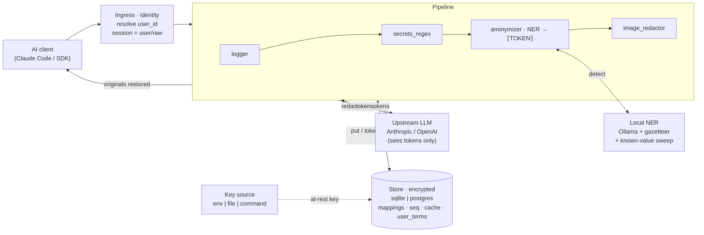
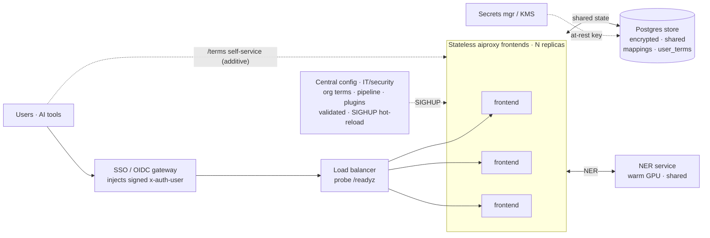

# aiproxy — Manual

Anonymizing reverse proxy for LLM APIs. Point any AI tool (Claude Code,
Claude Desktop, OpenAI SDKs, …) at aiproxy instead of the real provider.
aiproxy scrubs sensitive content locally, forwards the redacted request
upstream, and restores the originals in the reply — so the provider never
sees the real values but you still read them.

---

## 1. What it does and does not do

**Does**
- Detects people names, company/org names, locations, emails, phones (and
  high-confidence secrets like API keys, IBANs) using a *local* LLM + regex.
- Replaces each with a reversible token (`⟦PERSON_1⟧`), stored locally.
- Restores originals in the model's response (text only).
- Masks sensitive text in images and PDFs before sending.
- Redacts only genuine user messages and attached documents. Claude's own
  operational content — the Claude Code system prompt, CLAUDE.md, skills,
  slash-command text, `<system-reminder>` blocks and local command output —
  reaches the model verbatim, so redaction never corrupts how Claude works.
  Tune the boundary with `scope.redact_system` and `scope.skip_tags` (see §3).

**Does not**
- Guarantee 100% detection. An LLM can miss an entity. Use `fail_closed`
  mode, the `/dryrun` endpoint, and allow/deny lists to reduce risk.
- Restore redacted images/PDFs — pixel/true-redaction is **one-way**.
- Protect the mapping store. That file is the de-anonymization key; anyone
  with it reverses everything. Encrypt it and guard it.

### Threat model
aiproxy protects against the *upstream provider* (and anyone reading
upstream logs) seeing your sensitive data. It does **not** protect against
an attacker who already has your local machine or the mapping store.

### Use at your own risk — no warranty
aiproxy is provided **as is**, without warranty or condition of any kind, and
the authors accept **no liability** for any damages arising from its use — see
the **No Liability** clause in [`LICENSE`](../LICENSE). In plain terms:

- **Detection is not guaranteed.** The local LLM can miss an entity, so a real
  value can still reach the upstream provider. aiproxy reduces risk; it does not
  eliminate it. Run `fail_closed`, verify with `/dryrun`, and use the
  deterministic backstops (allow/deny lists, `always_tokenize`, the gazetteer).
- **You remain responsible** for validating that redaction is adequate for your
  data, and for any legal/compliance obligations (e.g. GDPR) you have toward the
  people whose data you process. The license governs only your relationship with
  the authors, not your obligations to third parties.
- **The mapping store is the de-anonymization key.** Losing control of it (and
  its encryption key) reverses every redaction. Guard both.

---

## 1b. Architecture

### Request / response flow (one replica)
The pipeline redacts on the way out and restores on the way in. The upstream
API only ever sees tokens; real values never cross the trust boundary. Both
directions share the encrypted store and the local NER model.



Identity resolution namespaces the session as `user_id/raw` so one user can
never reverse another's tokens. The anonymizer tokenizes reversibly; only
`denylist` hits are one-way `[REDACTED]`. The response path runs the same
processors in reverse.

### Organization deployment (scale-out)
Central config owned by IT/security; users self-serve terms, never config or
code. Frontends are stateless behind a load balancer once state lives in a
shared Postgres store and a warm shared NER service.



The critical path to multi-user is a shared store (Phase 1) + per-user
identity (Phase 2) + the per-user term tier (Phase 3). Full design and
sequencing: [`ORG_DEPLOYMENT.md`](ORG_DEPLOYMENT.md).

---

## 2. Install — single workstation

One person, one machine: local SQLite store and a local NER model. For a
shared multi-user service see [§2b](#2b-install--organization).

### Requirements

| | Minimum | Comfortable |
|---|---|---|
| OS | macOS, Linux, or Windows 10+ | same |
| Python | 3.11+ | 3.11+ |
| RAM free | 6 GB (CPU-only NER) | 8 GB or more |
| GPU | none — the 3B model runs on CPU | any GPU with ≥ 4 GB VRAM (much faster NER and startup pre-warm) |
| Disk | ~4 GB (Python deps + the 3B NER model; +50–60 MB if you build the binary) | SSD |
| Extra software | Ollama (local LLM runtime, `:11434`) and the Tesseract OCR binary — both installed for you by `install.sh` | |

The default NER model is `qwen2.5:3b-instruct` (~2 GB download). Text
anonymization needs only Ollama; the image/PDF/Office path also needs
Tesseract. OCR runs on CPU. Latency is dominated by local NER + OCR compute,
so a GPU is the single biggest speed-up on a workstation.

The installer handles everything beyond Python (Ollama, Tesseract, models,
key, config).

### Automatic (recommended)
From the repo root:

**macOS / Linux**
```bash
./install.sh
```
**Windows (PowerShell)**
```powershell
powershell -ExecutionPolicy Bypass -File .\install.ps1
```

The installer is re-runnable and does:
1. find Python ≥ 3.11, create `.venv`, install `aiproxy[media]`;
2. install Tesseract OCR (Homebrew / apt / dnf / pacman / winget);
3. install Ollama and start it (`:11434`);
4. create `config.yaml` from the example if missing;
5. `ollama pull` every model listed in `config.yaml` (`llm.models` or
   `llm.model`);
6. if `store.encrypt: true`, generate a key and print the
   `AIPROXY_STORE_KEY` to export.

System-package steps are best-effort; if one can't auto-install it prints
the manual command and continues. Then verify with the doctor (§4a).

### Manual
```bash
cd aiproxy
python -m venv .venv && source .venv/bin/activate
pip install -e .            # core (text anonymization)
pip install -e ".[media]"   # add image/PDF/Office redaction
pip install -e ".[dev]"     # add test deps
```
Local LLM (Ollama):
```bash
# install ollama (see ollama.com), then:
ollama pull qwen2.5:3b-instruct
ollama serve     # usually auto-starts; listens on :11434
```
Image/PDF/Office extras also need the Tesseract OCR binary:
```bash
sudo apt install tesseract-ocr     # Debian/Kali/Ubuntu
brew install tesseract             # macOS
winget install UB-Mannheim.TesseractOCR   # Windows
```

### Build a standalone binary (optional)

Produce a single self-contained `aiproxy` executable (no Python install
needed to run it) with PyInstaller:

**macOS / Linux**
```bash
./build.sh
# -> dist/aiproxy
```
**Windows (PowerShell)**
```powershell
powershell -ExecutionPolicy Bypass -File .\build.ps1
# -> dist\aiproxy.exe
```

The scripts create a throwaway `.venv-build`, install `aiproxy[media]` +
PyInstaller, and run `pyinstaller --clean --noconfirm aiproxy.spec`. Run the
result like the CLI: `./dist/aiproxy serve --config config.yaml`.

Important:
- **PyInstaller cannot cross-compile.** Build on each OS you need a binary
  for (a macOS binary must be built on macOS, etc.), or in CI.
- **Tesseract OCR and Ollama are NOT bundled** — they are separate programs
  aiproxy shells out to. Install them on the host as in §2 regardless.
- The binary bundles Python, all pip dependencies, and pypdfium2's native
  PDFium library (~50–60 MB). It does not auto-start on boot and does not
  create `config.yaml` — ship a config beside it or pass `--config`.

---

## 2b. Install — organization

A shared service for many users: central config owned by IT/security,
per-user identity and isolation, and horizontal scale. The full design,
phase-by-phase rollout and every config key are in
[`ORG_DEPLOYMENT.md`](ORG_DEPLOYMENT.md); this section covers what differs from
the workstation install. The topology diagram is in [§1b](#1b-architecture).

### Requirements

| | Notes |
|---|---|
| Proxy frontends | Stateless once state is external (store + NER). Each is cheap (CPU, ~1 GB RAM); run N behind a load balancer and scale horizontally. |
| Store | SQLite is single-writer/local — fine for one box, a bottleneck for many. Use `store.backend: postgres` with a managed Postgres for multiple frontends. |
| NER host | **One** host with a GPU, running the model warm and shared (see below). Sized for the model you choose, not per frontend. |
| Secrets | A secrets manager / KMS for the at-rest key (`store.key_source: command`); see [`KEY_MANAGEMENT.md`](KEY_MANAGEMENT.md). |
| Auth | An SSO/OIDC gateway in front injecting a signed identity header (`identity.source: header`), or per-user API keys (`identity.source: api_key`). |

### What changes vs. a workstation
- `store.backend: postgres` + `store.dsn` so frontends share one mapping store.
- `identity:` to resolve a `user_id` per request (sessions are namespaced so no
  user can reverse another's tokens).
- Users self-serve their own term lists at `/terms`; org terms stay in central
  config. Edit central config and `kill -HUP <pid>` to hot-reload — no restart.
- Point frontends at the shared NER host with `llm.url`.
- Load-balancer health probe: `/readyz` (503 until the store is reachable).

### Improving the local LLM at org scale
On a workstation the NER model is deliberately small (`qwen2.5:3b-instruct`) so
it cold-loads fast enough per request. A shared deployment removes that
constraint — the model is loaded **once** on a warm GPU host and reused by every
frontend — so you can run a much more accurate model. Recall (catching every
entity) is the whole game here, and a bigger model is the largest single lever.

- **Promote NER to a dedicated, warm, shared service.** Run Ollama on one GPU
  host; set every frontend's `llm.url` to it. The model stays resident, so the
  per-request cold-load cost that caps a workstation disappears.
- **Use a larger model, or an ensemble.** A 7–8B model catches names and orgs
  the 3B misses. An ensemble takes the *union* of several models' detections for
  still-higher recall:
  ```yaml
  llm:
    models: [qwen2.5:7b-instruct, llama3.1:8b]   # union of detections
    keep_alive: -1          # keep models resident (never unload)
  ```
  Latency is the **sum** of the models, so an ensemble is only practical when
  warm and shared, never per-request on a cold box. Budget ~8–16 GB VRAM for a
  single 7–8B model and more for an ensemble; size the GPU host accordingly.
- **Keep models resident** with `llm.keep_alive` (seconds, or `-1` for forever)
  so no request pays a load.
- **Tune for your data.** Expand `llm.entity_types` with types that matter to
  you, adjust the NER `llm.prompt`, and — the highest-leverage deterministic
  backstop — grow `anonymizer.name_gazetteer` from your directory (HR / Active
  Directory export) so known employee and client names are caught even when the
  model misses them. The known-value sweep then propagates any single catch
  across the rest of the session.
- **Queue + health.** Put a request queue in front of the shared NER service and
  gate frontends on `/readyz` so a replica whose NER is cold or down is pulled
  from rotation rather than failing sends.

---

## 3. Configure

```bash
cp config.example.yaml config.yaml
```

### Editing settings with `aiproxy config`
Change any setting without hand-editing YAML (comments are preserved; every
write is validated and rejected if it would break the config):
```bash
aiproxy config show                         # print the whole config
aiproxy config get llm.model
aiproxy config set listen.port 9000         # parsed as int
aiproxy config set store.encrypt true       # parsed as bool
aiproxy config set llm.models '[qwen2.5:3b-instruct, llama3.2:latest]'
aiproxy config set anonymizer.entities.PERSON redact
aiproxy config set scope.redact_system false   # keep the system prompt verbatim
aiproxy config unset llm.models
aiproxy config edit                         # interactive wizard
```
Values are parsed as YAML, so types are inferred (`9000`→int, `true`→bool,
`null`→None, `[a, b]`→list). `--config PATH` targets a non-default file.

Generate and export the store encryption key (required when
`store.encrypt: true`):
```bash
export AIPROXY_STORE_KEY="$(python -m aiproxy genkey)"
```
Keep this key out of the config file and out of version control. Losing it
makes existing mappings unreadable (= permanent anonymization).

Key config fields (full list in `config.example.yaml`):

| Key | Meaning |
|-----|---------|
| `listen` | host/port aiproxy binds to |
| `upstreams.<provider>.base_url` | real API aiproxy forwards to (override with env `AIPROXY_UPSTREAM_<PROVIDER>`, e.g. `AIPROXY_UPSTREAM_ANTHROPIC`; env wins and can add a provider) |
| `llm.url` / `llm.model` | local Ollama endpoint + model for NER |
| `llm.entity_types` | entity labels the model may return; enum-constrains the schema (default `PERSON, ORG, LOCATION, EMAIL, PHONE`). Add a custom type's action under `anonymizer.entities` too. Tip: drop `PHONE` here and let `secrets_regex` own phone numbers — the deterministic regex (digit-count validated) is far more reliable than the small model, which mislabels version/filename strings like `v2` as PHONE |
| `llm.prompt` | override the NER prompt; must contain `{text}`, optional `{types}` filled from `entity_types` |
| `llm.cache_ttl` | seconds to keep in-memory NER results (`null` = forever) |
| `llm.timeout` | seconds per NER request (default 60; model-load counts toward it) |
| `llm.warm_timeout` | seconds allowed for the startup pre-warm cold load (default 300) |
| `prewarm` | load the model at startup so the first request skips the cold-load cost (default true) |
| `pipeline` | ordered processor list (request top→bottom, restore bottom→top) |
| `mode` | `fail_closed` (block on filter error), `fail_open` (send original on error), or `observe` (never redact — forward every request un-redacted and just log it; **sends real data upstream in the clear**, diagnostic only) |
| `scope.redact_system` | redact the top-level system prompt too? Default `false` — the Claude Code system prompt + CLAUDE.md pass through verbatim |
| `scope.skip_tags` | tags whose `<tag>…</tag>` regions are never redacted wherever they appear in a message (skills, slash-command text, system reminders, local command output); default list in `config.example.yaml` |
| `scope.skip_prefixes` | protect a whole text block when its stripped text starts with any of these — catches operational blocks Claude Code injects untagged (`# Environment`, `You are Claude Code`, `Direct output style is active`, `[SUGGESTION MODE`). Every other block (all user **and** assistant turns, plus documents) is redacted, so repeated PII maps to the same token |
| `scope.skip_regexes` | same as `skip_prefixes` but the block is protected when any regex matches it (`re.search`, DOTALL); for operational blocks not pinned to the start |
| `anonymizer.entities` | per-type action: `anonymize` / `redact` / `ignore` |
| `anonymizer.allowlist` | strings never redacted |
| `anonymizer.denylist` | strings always redacted **irreversibly** (replaced with `[REDACTED]`, never restored); substring match |
| `anonymizer.always_tokenize` | strings always masked **reversibly** (a `⟦TERM_n⟧` token, restored on the response) regardless of the entity action map; substring match. Use for a known-sensitive value that must be hidden from upstream yet still appear in Claude's output (e.g. a client name in a document Claude generates). The deterministic, LLM-independent guarantee for known strings |
| `anonymizer.known_value_sweep` | re-mask any value already tokenized earlier in the session in every later block, even when the NER misses it there (default `true`). Closes the "caught once, leaked later" recall gap; reuses each value's existing token |
| `anonymizer.known_value_sweep_min_len` | shortest value the sweep will re-mask (default `4`), to avoid pathological substring matches on very short strings |
| `anonymizer.name_gazetteer` | path to a file of known name **parts** (one per line, given names + surnames). Known parts are joined into one PERSON across spaces **and** `.`/`_`/`-` separators, and an uppercase initial before a known surname counts (`Maria Silva`, `john.rivera`, `john_rivera`, `J. Rivera`) — matched case-insensitively, so it also catches a lowercase dotted username inside a file path or URL. Precision rests on the curated list. Blank/omitted = off |
| `anonymizer.name_gazetteer_min_parts` | shortest run of adjacent known parts that counts as a name (default `1`; set `2` to mask only multi-part names and avoid masking a lone first name that doubles as a common word) |
| `store.encrypt` | encrypt originals at rest (needs `AIPROXY_STORE_KEY`) |
| `redaction_log.debug` | also log the original (plaintext) message text alongside the redacted version — real PII on disk; leave `false` outside a trusted env |
| `redaction_log.log_all` | log **every** text block, not just the ones that were redacted (default `false`); operational blocks still appear as placeholders unless `mode: observe` |

---

## 4a. Doctor — verify the setup

Before (or any time after) running, check everything is in place:
```bash
python -m aiproxy doctor --config config.yaml
```
It verifies Python, dependencies, the Tesseract binary, config load, the
store (and `AIPROXY_STORE_KEY` when `store.encrypt: true`), the archive dir
(if set), Ollama reachability, and that every model in the config is pulled.
Required failures exit non-zero; optional gaps (e.g. missing Tesseract) are
`WARN`. Example line: `[FAIL] model pulled: qwen2.5:3b-instruct — run:
ollama pull qwen2.5:3b-instruct`.

## 4. Run

```bash
python -m aiproxy serve --config config.yaml
# listening on http://127.0.0.1:8088   (per listen.port)
```

Health check: `curl http://127.0.0.1:8080/healthz` (liveness).
Readiness: `curl http://127.0.0.1:8080/readyz` — 200 when the store is
reachable, 503 otherwise (use it as the load-balancer probe).

### Dashboard
`http://127.0.0.1:8080/dashboard` — live counts (auto-refresh): requests,
text parts redacted, tokens created, entities by type, documents by kind
(image/pdf/office), cache hits, NER blocks, sessions, and durable store
totals. Raw JSON at `/metrics`. Counts are non-sensitive (how many, never
the values). Runtime counters reset on restart; store totals persist.

> By default redacted documents are **not** written to disk — they are
> forwarded upstream and discarded; only token↔original mappings and the
> text redaction cache persist in the `store.path` SQLite file. Set
> `archive.dir` to also keep redacted documents on disk (see below).

### Document archive + disk cache (`archive.dir`)
Set `archive.dir` to a directory and each redacted document (image / PDF /
Office) is written there, named by a hash of its **original**. That store
doubles as a cache: presenting the same original again reads the redacted
version from disk and **skips the local LLM / OCR** entirely
(`document_cache_hits` on the dashboard). Only redacted output is written —
never the original PII-bearing bytes. Image/PDF entries are content-scoped
(reused across sessions); Office entries are session-scoped (their tokens
must resolve against that session's mappings). Omit `archive.dir` to
disable. Delete the directory to clear the cache.

### Point your tool at it

**Claude Code / Anthropic SDK:**
```bash
export ANTHROPIC_BASE_URL=http://127.0.0.1:8080
export ANTHROPIC_API_KEY=sk-ant-...   # your real key; aiproxy passes it through
```

The proxy exposes `/v1/messages` (Anthropic) and `/v1/chat/completions`
(OpenAI). For OpenAI tools set the base URL to `http://127.0.0.1:8080/v1`
and add `upstreams.openai` in config. Images redact only when inlined as a
`data:` URL; remote `http(s)` image URLs pass through unmasked. The OpenAI
Chat Completions API has no PDF part.

Streaming works: `stream:true` requests are forwarded as a stream and
tokens are restored on the fly, even when a `⟦PERSON_1⟧` sentinel is split
across SSE chunks (`aiproxy/proxy/stream.py`). Only text deltas are
restored; tool-call argument fragments (`input_json_delta`) pass through
untouched.

### Preview redactions without sending (`/dryrun`)
```bash
curl -s http://127.0.0.1:8080/dryrun \
  -H 'content-type: application/json' \
  -d '{"messages":[{"role":"user","content":"email bob@acme.com"}]}'
```
Returns the body *as it would be forwarded* — inspect it to tune your
config before trusting the proxy with real traffic.

---

## 5. Managing the mapping store

Sessions are keyed per-conversation (by `x-aiproxy-session` header, else a
hash of the API key + first message).

Purge one session's mappings:
```bash
python -m aiproxy purge --config config.yaml --session <session-id>
```

Back up `map.db` **and** `AIPROXY_STORE_KEY` together, or treat both as
ephemeral — one without the other is useless.

### Store backend
`store.backend` is `sqlite` (default, single-box) or `postgres` (shared,
multi-writer — for several proxy replicas behind a load balancer). Postgres
needs `store.dsn` and the `psycopg` package (`pip install 'psycopg[binary]'`).
Both backends encrypt originals at rest with the same key.

### Where the at-rest key comes from
`store.key_source` is `env` (default — `AIPROXY_STORE_KEY`), `file`
(`key_path`, a mounted secret) or `command` (`key_command`, shell out to a
secrets manager / KMS CLI; its stdout is the key). This keeps no long-lived
secret in the config file. Key rotation and per-tenant keys:
[`docs/KEY_MANAGEMENT.md`](KEY_MANAGEMENT.md).

---

## 5b. Multi-user / organization deployment

For a shared proxy owned by IT/security with many users, aiproxy adds identity,
per-user term self-service, hot-reload and scale-out. Full design and rollout
sequencing: [`docs/ORG_DEPLOYMENT.md`](ORG_DEPLOYMENT.md). The moving parts:

- **Identity** (`identity.source`): `anonymous` (default, single namespace),
  `api_key` (map an inbound key → `user_id` via `identity.keys`), or `header`
  (trust a signed identity header from an SSO/OIDC gateway in front). Mappings
  are isolated per user — one user can never reverse another's tokens.
- **Per-user terms** (Phase 3): each user manages their **own**
  `always_tokenize`/`denylist` strings at `GET/POST/DELETE /api/terms` or the
  `http://127.0.0.1:8080/terms` page. They are additive and merge on top of the
  org lists in config; a user can never weaken org coverage. Added terms take
  effect within `anonymizer.user_terms_ttl` seconds, no restart.
- **Hot-reload**: edit central config and send `SIGHUP`
  (`kill -HUP <pid>`) — the pipeline and upstreams swap in place without
  dropping the store. Invalid config is rejected and the running config kept
  (fail closed).
- **Scale-out**: `store.backend: postgres` lets N stateless frontends share one
  store; `/readyz` (503 until the store is reachable) is the load-balancer
  probe. Per-user request counts appear in `/metrics`.
- **Hardening**: keep `mode: observe`, `redaction_log.debug` and `log_all` off
  in production — they leak real data upstream / to disk and now log a loud
  warning at startup when set.

---

## 6. Writing a custom processor

A processor is the single plug point. Implement two methods:

```python
from aiproxy.document import Document, PartKind
from aiproxy.pipeline.base import Processor, SessionContext

class MyFilter(Processor):
    name = "my_filter"
    handles = frozenset({PartKind.TEXT})

    def process_request(self, doc: Document, ctx: SessionContext) -> Document:
        for part in doc.text_parts():
            part.text = part.text.replace("secret", "[gone]")
        return doc

    def process_response(self, doc: Document, ctx: SessionContext) -> Document:
        return doc
```

Register it in `aiproxy/pipeline/registry.py`:
```python
from aiproxy.processors.my_filter import MyFilter
BUILTINS[MyFilter.name] = MyFilter
```

Add its name to `pipeline:` in config. For reversible redaction, use
`ctx.store.put/token_for/original_for` and the token helpers in
`aiproxy/processors/tokens.py`. Scope every stored mapping by
`ctx.session_id`.

> **Contributing to aiproxy itself?** The developer guide
> [`DEVELOPING.md`](DEVELOPING.md) covers the architecture internals, the
> `Document`/`Processor`/`Store` abstractions, how to make common changes, the
> tag-based release flow, and the PR workflow and checklist.

### Drop-in plugins (no code edit)
For an organization, a reviewed processor can be loaded without editing
`registry.py` — dropped as a file or installed as a pip package — and enabled
with a one-line `pipeline:` change. This **executes code with full proxy
privileges**, so it is an admin path (default off), gated by review,
name-collision refusal and audit logging. Full workflow and the `plugins:`
config block: [`docs/WRITING_A_PROCESSOR.md`](WRITING_A_PROCESSOR.md).

---

## 7. Image & PDF behavior

- Images: OCR → NER → opaque black boxes over flagged words → re-encoded
  PNG sent upstream.
- PDFs (all kinds): every page is rasterized at `image_redactor.dpi`
  (pypdfium2 render), then treated as an image (OCR → NER → opaque mask
  boxes). The masked page rasters are reassembled into an image-only PDF.
  This covers text pages, scanned pages, and embedded images uniformly and
  leaves no hidden text layer upstream. Tradeoff: the forwarded PDF is
  image-based (no selectable text); text masking is OCR-driven, so OCR
  quality bounds detection. No AGPL dependency (pypdfium2 is Apache-2.0/BSD).
- Office docs (OOXML `.docx`/`.pptx`/`.xlsx`, incl. SharePoint exports):
  body **text** in `<w:t>`/`<a:t>`/`<t>` nodes is tokenized reversibly
  (by the anonymizer, same tokens as plain text — so the model's reply
  restores), and every image under `*/media/` is inspected and masked
  (by image_redactor). All other bytes (namespaces, formatting,
  relationships) are preserved. Limit: an entity split across multiple
  runs (separate `<w:t>` nodes) is detected but only masked if it sits in
  one node — reflow the source or convert to PDF for such cases.
- `image_redactor.max_pages` caps work per PDF.
- One-way: nothing about a masked region is restorable.

### Caching
- **NER result cache** (in-memory, per model+text): a reloaded model never
  re-runs NER on text it already saw. Bounded by `llm.cache_ttl` seconds.
- **Per-document redaction cache** (persistent, in the store, per session):
  the exact redacted output of a text is stored by hash, so a re-presented
  document (e.g. the same conversation history resent each turn) skips NER
  and replacement entirely. Cleared by `purge`.

---

## 8. Troubleshooting

| Symptom | Likely cause / fix |
|---------|--------------------|
| `NER failed, blocking send` | Ollama not running / wrong `llm.url`. Start `ollama serve`. |
| Names still reaching upstream | the LLM missed them (recall). For a known fixed string use `always_tokenize` (reversible) or `denylist` (irreversible); for people's names add the parts to `name_gazetteer`. The `known_value_sweep` then propagates any single catch across the rest of the session. Run `/dryrun` to verify. |
| `AIPROXY_STORE_KEY not set` | export the key, or set `store.encrypt: false` (dev only). |
| `tesseract not found` | install the Tesseract binary (§2). |
| Slow responses | NER + OCR are local-compute heavy; results cache by text hash. |

---

## 9. Tests

```bash
pytest
```
`tests/test_roundtrip.py` proves tokenize→store→restore with the
deterministic secrets filter (no LLM needed).

---

## 10. License

aiproxy is licensed under the **PolyForm Noncommercial License 1.0.0**
(`LICENSE` at the repo root): you may use, copy, modify, and distribute it
for any **noncommercial** purpose, free of charge. Commercial use is not
granted by that license. Copyright and all intellectual property are
retained by the authors, who reserve all commercial rights — a separate
commercial license is available on request (`NOTICE`).

Third-party dependencies are all permissive (MIT/BSD/Apache) and keep their
own licenses; see `THIRD_PARTY_LICENSES.md`. The project deliberately uses
no copyleft dependencies — PyMuPDF (AGPL-3.0) was replaced with pypdfium2
(BSD/Apache) so the whole service can be offered under noncommercial-only
terms. Local model weights (e.g. Llama 3.2, Qwen2.5) are licensed by their
publishers and are the operator's responsibility; aiproxy bundles no weights.
